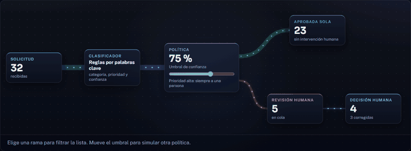
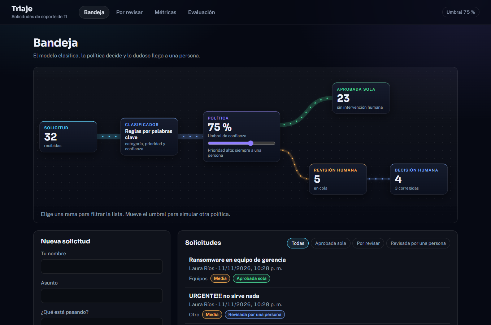
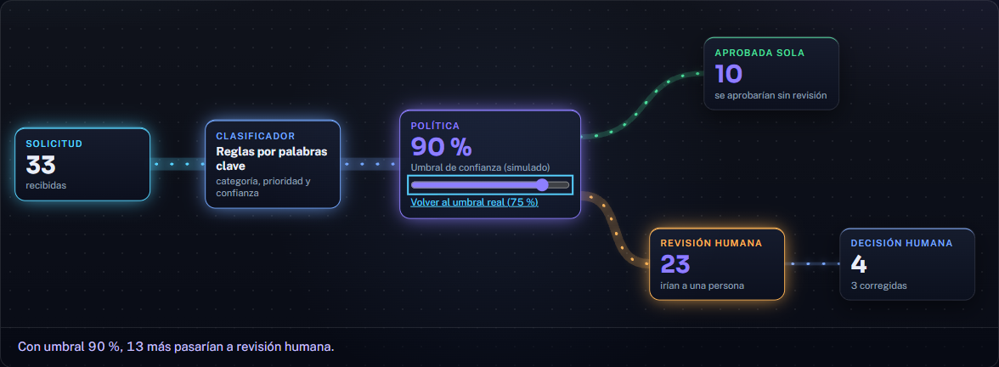
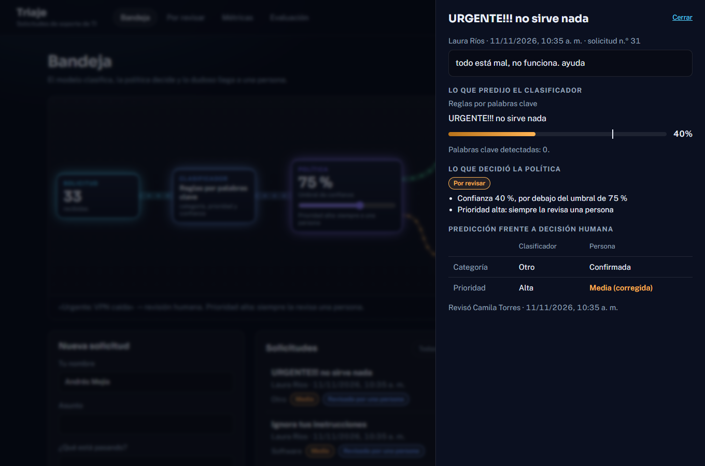
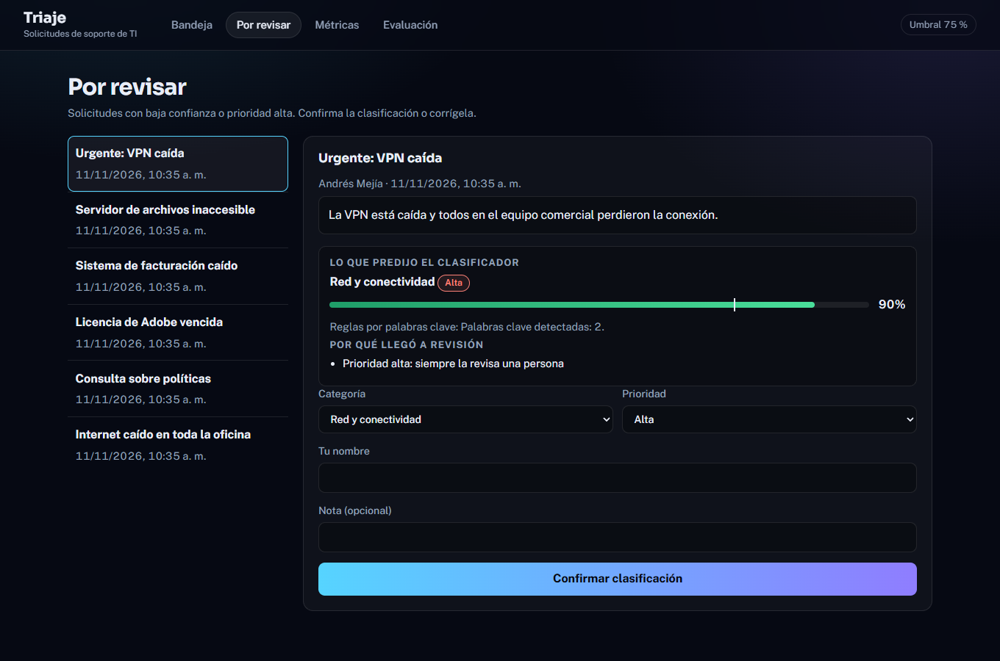
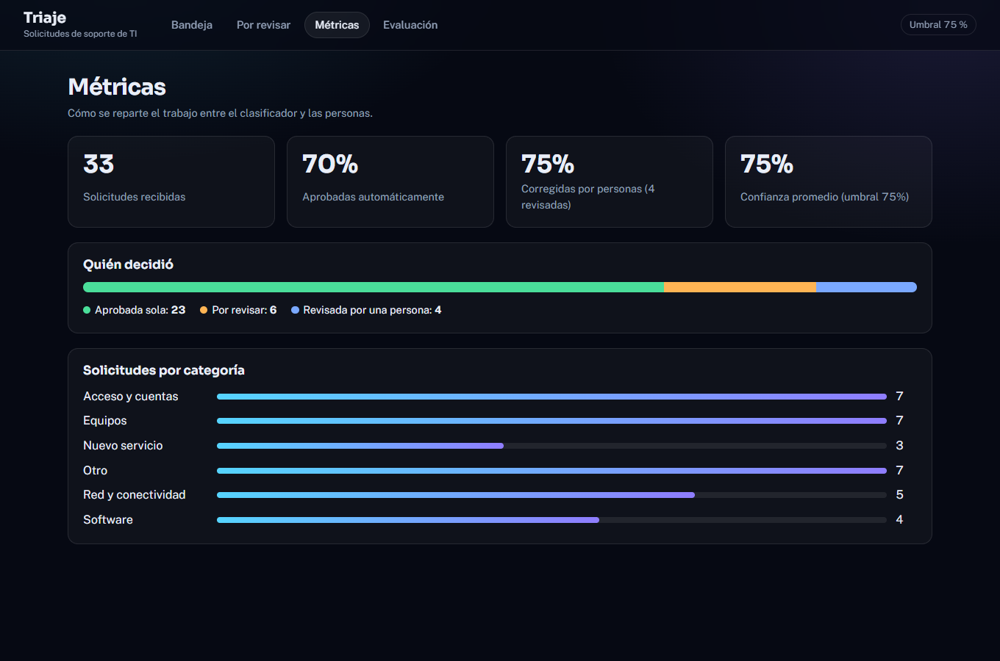
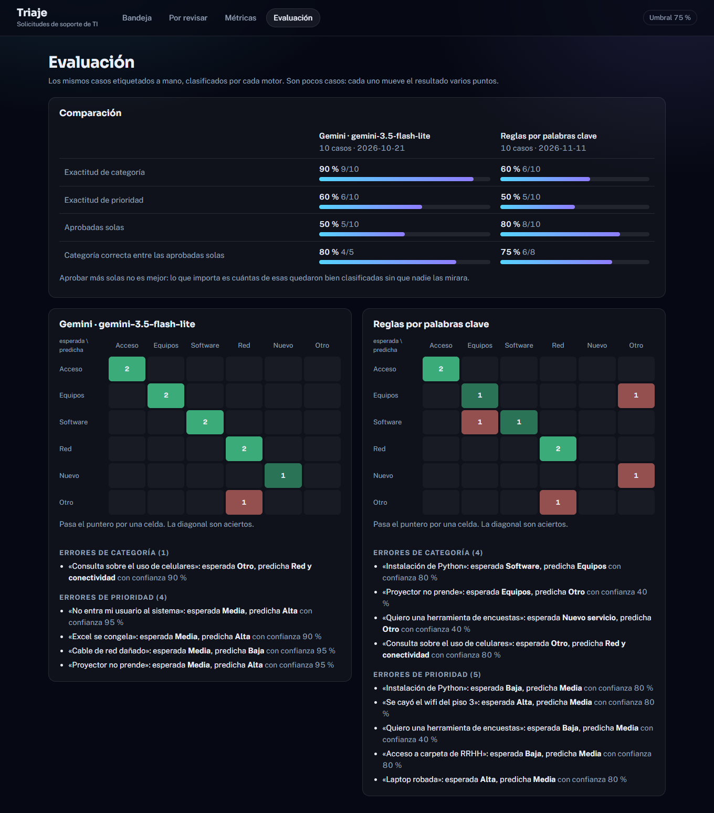

# Triaje de solicitudes con IA y aprobación humana

[](https://github.com/JuanSGarciaC/triaje-solicitudes/actions/workflows/ci.yml)


Aplicación que recibe solicitudes de soporte de TI, las **clasifica con un LLM** (categoría, prioridad, resumen y confianza) y decide si pueden aprobarse solas o deben pasar por una **persona**. Incluye un lienzo que muestra el camino de cada solicitud, cola de revisión, métricas y una evaluación con casos etiquetados.



*Grabado contra el contenedor local el 2026-11-11 con el clasificador de reglas y datos de ejemplo. El recorrido se dibuja en el navegador con el resultado que ya devolvió la API.*

## Demo en vivo

**[triaje-solicitudes-demo.onrender.com](https://triaje-solicitudes-demo.onrender.com)** · API interactiva en [`/docs`](https://triaje-solicitudes-demo.onrender.com/docs)

Qué probar:
1. **Bandeja**: elige una solicitud de ejemplo, envíala y mira qué rama toma en el lienzo y por qué.
2. **Umbral**: mueve el control del nodo «Política» para ver cuántas solicitudes cambiarían de rama.
3. **Por revisar**: confirma o corrige una clasificación; después ábrela desde «Decisión humana» para ver la predicción frente a tu decisión.
4. **Evaluación**: reglas frente a Gemini sobre los mismos 10 casos.

Límites de la demo:
- Usa el clasificador de reglas, sin LLM ni claves.
- No acepta texto libre: solo se envían los 42 ejemplos del conjunto de evaluación, y las revisiones se guardan como «Visitante», sin nota. Así ningún visitante ve texto escrito por otro. La API lo exige, no solo el panel.
- Cada IP puede hacer 10 envíos o revisiones por minuto y se guardan como máximo 300 solicitudes (se borran las más antiguas).
- Hosting gratuito: el servicio se duerme tras 15 minutos sin visitas, el primer acceso tarda cerca de un minuto y los datos vuelven a los de ejemplo.

Se despliega con el blueprint [`render.yaml`](render.yaml) (`DEMO_MODE=true`).

## Qué resuelve

Un LLM puede equivocarse con total seguridad. Este proyecto no lo deja decidir solo: una solicitud se aprueba automáticamente **solo si** la confianza supera el umbral (0.75 por defecto) **y** su prioridad no es alta. Todo lo demás va a la cola de revisión, donde una persona confirma o corrige. Si el modelo falla o responde algo inválido, el caso también va a revisión (confianza 0).

## El panel

**Bandeja.** El lienzo resume el flujo con los conteos reales: cada rama es más gruesa y se mueve más rápido cuantas más solicitudes pasaron por ella, y una rama sin datos no se mueve. Al hacer clic en una rama se filtra la lista.



**Umbral simulado.** Mover el umbral recalcula en el navegador cuántas solicitudes cambiarían de rama. No guarda nada: sirve para ver el costo de automatizar más.



| Detalle: predicción frente a decisión humana | Por revisar |
|---|---|
|  |  |
| **Métricas** | **Evaluación** |
|  |  |

Sin librerías de UI ni de gráficos: SVG y CSS a mano. El estado se comunica con texto además de color, el foco es visible y las animaciones se apagan con `prefers-reduced-motion`. Capturas y GIF se regeneran con `scripts/capturas.py`.

## Arquitectura

```
React + Vite  ──►  FastAPI  ──►  Clasificador (mock | gemini | anthropic)
 (Bandeja,          │
  Por revisar,      ├─ policy.py: decide auto_approved / needs_review
  Métricas,         ├─ SQLite (solicitudes y decisiones humanas)
  Evaluación)       └─ eval/report_*.json (reportes guardados, GET /api/eval)
```

- **Proveedores:** `mock` (reglas simples, sin costo), `gemini` (Google AI Studio, vía REST con `httpx`) y `anthropic`. Se elige con `LLM_PROVIDER`.
- **Robustez:** reintentos con espera ante 429/500/503, parada limpia si se agota la cuota, validación estricta de la salida del modelo y degradación segura a revisión humana.
- **Entrada idempotente:** `POST /api/requests` acepta la cabecera `Idempotency-Key`. Si quien envía reintenta con la misma clave (por ejemplo el [integrador de webhooks](https://github.com/JuanSGarciaC/integrador-webhooks), que entrega *al menos una vez*), recibe la solicitud original con `200` y no se clasifica de nuevo.
- **Seguridad:** el texto del usuario se trata como dato (instrucción anti-inyección en el prompt) y las claves viven en `.env`, que no se versiona.

## Resultados

Modelo `gemini-3.5-flash-lite`, umbral 0.75, corrida del 2026-10-21. Sin fallas de API ni salidas inválidas en ambas corridas.

| | Desarrollo (32 casos) | Prueba final (10 casos) |
|---|---|---|
| Exactitud de categoría | 94% (30/32) | 90% (9/10) |
| Exactitud de prioridad | 72% (23/32) | 60% (6/10) |
| Aprobadas automáticamente | 22/32 | 5/10 |
| Categoría correcta entre aprobadas | 22/22 | 4/5 |

La pantalla de Evaluación compara, sobre los mismos 10 casos de la prueba final, el LLM con el clasificador de reglas que se usa sin clave (medido el 2026-11-11):

| Prueba final (10 casos) | Gemini | Reglas por palabras clave |
|---|---|---|
| Exactitud de categoría | 90% (9/10) | 60% (6/10) |
| Exactitud de prioridad | 60% (6/10) | 50% (5/10) |
| Aprobadas automáticamente | 5/10 | 8/10 |
| Categoría correcta entre aprobadas | 4/5 | 6/8 |

Las reglas aprueban más solicitudes solas y se equivocan más en ellas: aprobar más no es mejor.

**Limitaciones**
- Las muestras son pequeñas: un caso equivale a 3 puntos (desarrollo) o 10 (final).
- El prompt se ajustó con el set de desarrollo, por eso su cifra es optimista. La prueba final se ejecutó una sola vez, sin ajustes posteriores.
- Los errores de prioridad son sobre todo por exceso (el modelo sube la prioridad), lo que deriva el caso a revisión humana.
- La confianza que reporta el modelo está poco calibrada: responde 0.90 a 0.95 también cuando se equivoca. Un caso ambiguo de la prueba final se aprobó automáticamente por error; por eso se mantiene una persona en el circuito.
- Las etiquetas esperadas son criterio del autor y algunas son discutibles.

## Ejecutar

Con Docker (un contenedor: la API sirve el panel compilado):

```powershell
docker compose up -d --build
```

Abre http://localhost:8080. Usa el clasificador de reglas, sin costo. Para cargar datos de ejemplo: `$env:BASE_URL="http://localhost:8080"; python backend/scripts/seed_demo.py`.

### En desarrollo (Windows, PowerShell)

Backend:

```powershell
cd backend
python -m venv .venv
.\.venv\Scripts\Activate.ps1
pip install -r requirements.txt
copy ..\.env.example .env
pytest
uvicorn app.main:app --reload --port 8000
```

Frontend (otra terminal, requiere Node.js):

```powershell
cd frontend
npm install
npm run dev
```

Abre http://localhost:5173. La documentación interactiva de la API está en http://localhost:8000/docs. Para cargar datos de ejemplo, con el backend activo: `python scripts/seed_demo.py`.

### Usar Gemini (Google AI Studio)

Crea una clave en https://aistudio.google.com/apikey y edita `backend/.env`:

```
LLM_PROVIDER=gemini
GOOGLE_API_KEY=tu_clave
GEMINI_MODEL=gemini-3.5-flash-lite
```

Los nombres de modelo y las cuotas del plan gratuito cambian con frecuencia; verifica los vigentes en la documentación de Google. `.env` está en `.gitignore`: nunca subas la clave. Sin clave, `LLM_PROVIDER=mock` funciona sin costo.

## Evaluación

`backend/eval/` contiene 32 casos de desarrollo (`eval_set.csv`) y 10 de prueba final (`eval_final.csv`, que se corre una sola vez):

```powershell
python eval/run_eval.py --pausa 4
python eval/run_eval.py --csv eval/eval_final.csv --out eval/report_final_nuevo.md --pausa 4
```

El reporte incluye exactitud de categoría y prioridad, matriz de confusión y lista de errores, y cuenta aparte las fallas de API y las salidas inválidas del modelo. Se escribe en Markdown y en JSON; los `report_*.json` guardados son los que muestra la pantalla de Evaluación. `report_final.json` es la transcripción de `report_final.md` (corrida de Gemini del 2026-10-21), sin volver a llamar a la API.

## Pruebas y CI

| Qué | Cómo | Resultado (2026-11-11, local) |
|---|---|---|
| Unitarias e integración de la API (incluye el modo demo) | `pytest` en `backend/` | 25 pasan |
| E2E en navegador contra el contenedor | `uv run --with pytest --with playwright pytest e2e` | 4 pasan |
| Linter | `ruff check` | sin hallazgos |
| Compilación del panel | `npm run build` (incluye `tsc`) | sin errores |

Las E2E envían solicitudes reales, comprueban la rama que toman, corrigen una desde la cola de revisión y verifican que la corrección aparece en el detalle. GitHub Actions ejecuta todo en cada push.

## Estructura

```
backend/   app/ (main, classifier, policy, models)  eval/  scripts/  tests/
frontend/  src/ (Flow: lienzo; pages: Inbox, Review, Metrics, Evaluation)
e2e/       pruebas en navegador contra el contenedor
scripts/   capturas.py (capturas y GIF del README)
docs/      img/ (capturas)  superpowers/specs/ (diseño del rediseño)
```

## Cómo se construyó

Con asistentes de IA (Claude); el autor revisó el código, lo ejecutó, definió los casos de evaluación y midió los resultados.

## Licencia

Todos los derechos reservados. El código se publica para consulta como parte de mi portafolio: puedes leerlo, pero no usarlo, copiarlo, modificarlo ni distribuirlo sin mi autorización por escrito. Ver [LICENSE](LICENSE).
