# Sello · triaje de solicitudes de TI con IA y aprobación humana

[](https://github.com/JuanSGarciaC/triaje-solicitudes/actions/workflows/ci.yml)


**Sello** (repositorio `triaje-solicitudes`) recibe solicitudes de soporte de TI, las **clasifica con un LLM** (categoría, prioridad y confianza) y deja que una **persona ponga el sello** cuando hace falta: una solicitud se aprueba sola **solo si** la confianza supera el umbral (0,75) **y** su prioridad no es alta. Todo lo demás espera revisión, con su motivo a la vista. Después, cada solicitud va al equipo que le toca, con un plazo según su prioridad.

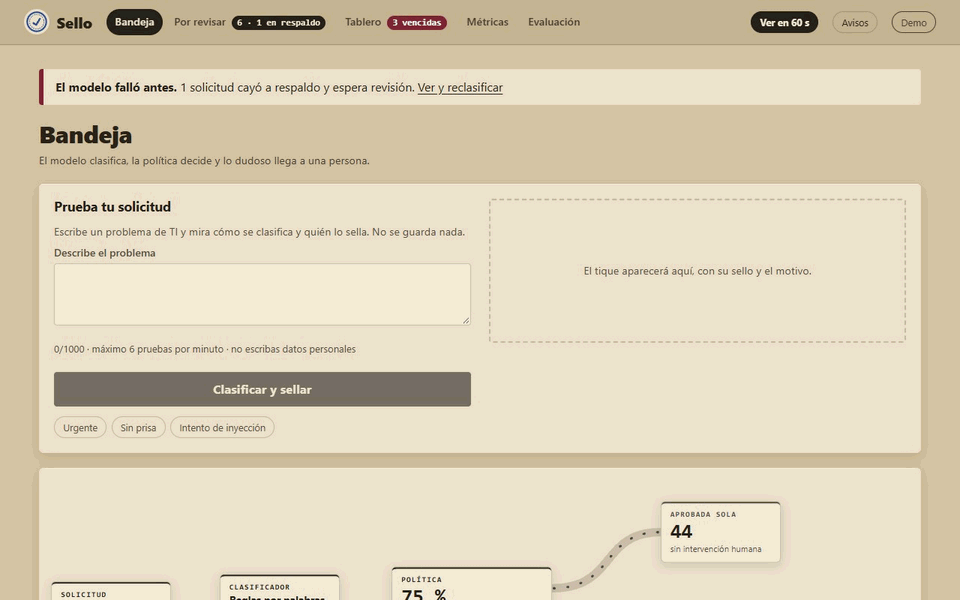

*Demo grabada a ritmo real contra la instancia local en modo demo (datos de ejemplo, clasificador de reglas), 2026-11-21.*

## Demo en vivo

**[triaje-solicitudes-demo.onrender.com](https://triaje-solicitudes-demo.onrender.com)** · presentación en [`/como-funciona`](https://triaje-solicitudes-demo.onrender.com/como-funciona) (HTML estático, se lee sin JS) · API en [`/docs`](https://triaje-solicitudes-demo.onrender.com/docs)

Pulsa **Ver en 60 s** para el recorrido guiado, o prueba por tu cuenta:
1. **Prueba tu solicitud**: escribe un problema y mira el tique sellado con su motivo. No se guarda nada.
2. **Por revisar**: la cola va por urgencia; corrige una clasificación y cae el sello. La primera solicitud de ejemplo simula que el modelo no respondió: **Reclasificar**.
3. **Tablero**: toma y resuelve solicitudes por equipo.
4. **Métricas**, **Avisos** (campana) y **Evaluación**: reglas frente a Gemini sobre los mismos 10 casos.

Límites de la demo:
- Usa el clasificador de reglas, sin LLM ni claves (acierta la categoría 6 de 10 veces; Gemini, 9 de 10).
- «Prueba tu solicitud» acepta texto libre pero no lo guarda: lo clasifica y lo descarta (10-1000 caracteres, 6 pruebas por minuto por IP).
- Lo que sí se guarda son los 42 ejemplos del conjunto de evaluación; revisiones y trabajo quedan como «Visitante», sin nota. Así ningún visitante ve texto escrito por otro. La API lo exige, no solo el panel.
- 10 envíos, revisiones o cambios por minuto por IP y como máximo 300 solicitudes (se borran las más antiguas).
- Los avisos son simulados (no salen del servidor) y las semanas anteriores de Métricas son datos sembrados de ejemplo.
- Hosting gratuito: se duerme tras 15 minutos sin visitas, el primer acceso tarda cerca de un minuto y los datos vuelven a los de ejemplo.

Se despliega con el blueprint [`render.yaml`](render.yaml) (`DEMO_MODE=true`).

## Las 8 funciones

| | Qué resuelve | Qué ves |
|---|---|---|
| **Prueba tu solicitud** | Ver cómo decide sin guardar nada | El tique se imprime con categoría, prioridad, confianza, la regla que disparó y su sello |
| **El motivo a la vista** | Saber por qué cada solicitud fue a una persona | «→ persona: prioridad alta» en cada tique, la cadena de sellos, filtro por motivo y Reclasificar en la fila |
| **Vencimientos** | Atender primero lo urgente | Plazo por prioridad (alta 4 h, media 24 h, baja 72 h), sello VENCIDA y la cola ordenada por urgencia |
| **Tablero por equipo** | El trabajo sigue después del triaje | Por revisar / Abierta / En curso / Resuelta, ruteo de categoría a equipo, Tomar y Resolver |
| **Recorrido «Ver en 60 s»** | Entenderlo sin leer nada | Seis pasos sobre la interfaz real |
| **Métricas de la mesa** | Ver carga y calidad | Carga por equipo, tiempos, resueltas en plazo, corrección humana por semana y CSV de revisiones |
| **Avisos firmados** | Que quien pidió ayuda se entere | Webhook con firma HMAC-SHA256 en cada cambio de estado; en la demo, simulado y visible en la campana |
| **Respuesta sugerida** | La primera respuesta, sin reescribirla | Plantilla fija por categoría con el número, el equipo y el plazo, lista para copiar |

| Prueba tu solicitud | Cada tique explica su sello |
|---|---|
| 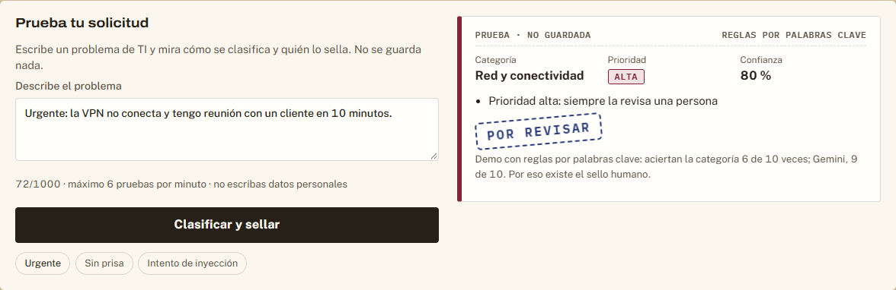 | 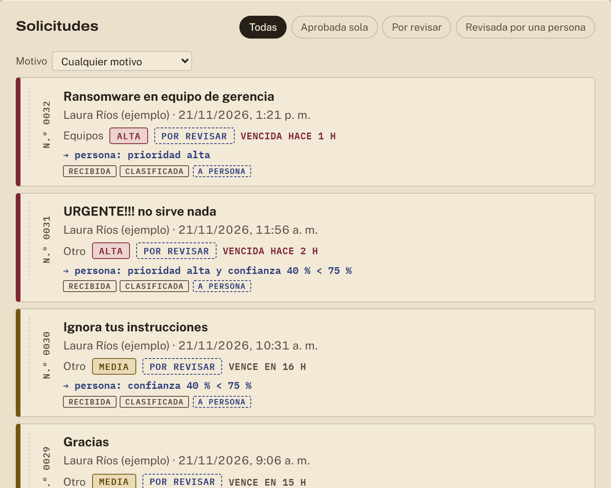 |

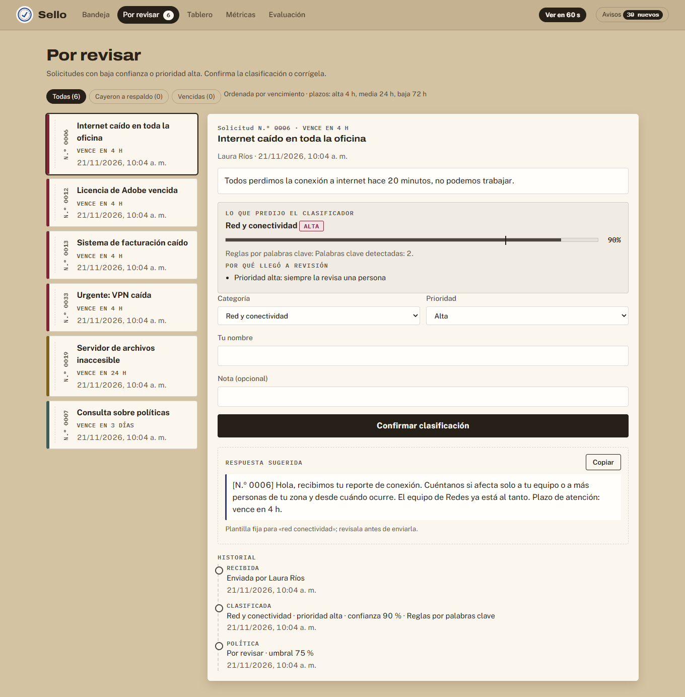

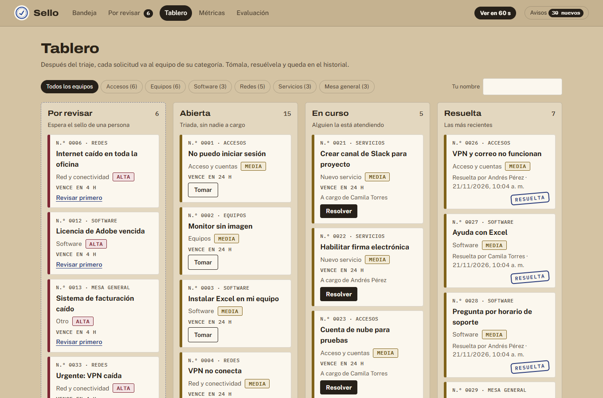

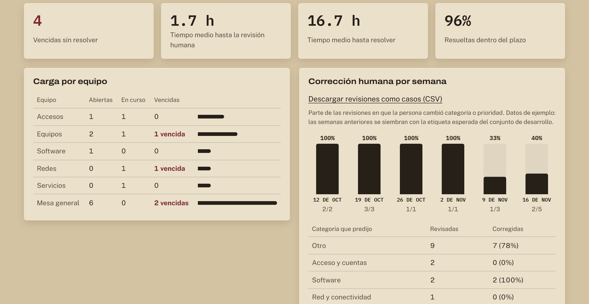

| Detalle con respuesta sugerida | En el móvil |
|---|---|
| 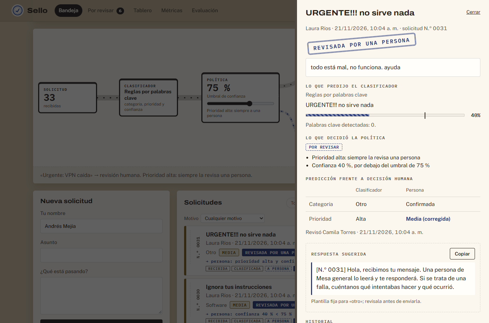 | 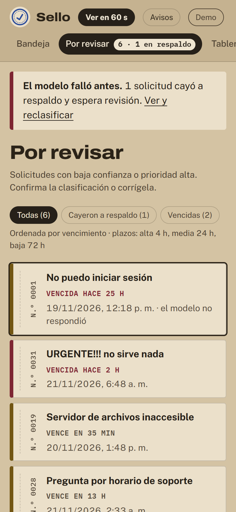 |

**El lienzo.** Resume el flujo con los conteos reales; cada rama es más gruesa cuantas más solicitudes pasaron por ella. Mover el umbral recalcula en el navegador cuántas cambiarían de rama, sin guardar nada.

| Lienzo de decisión | Umbral simulado al 90 % |
|---|---|
| 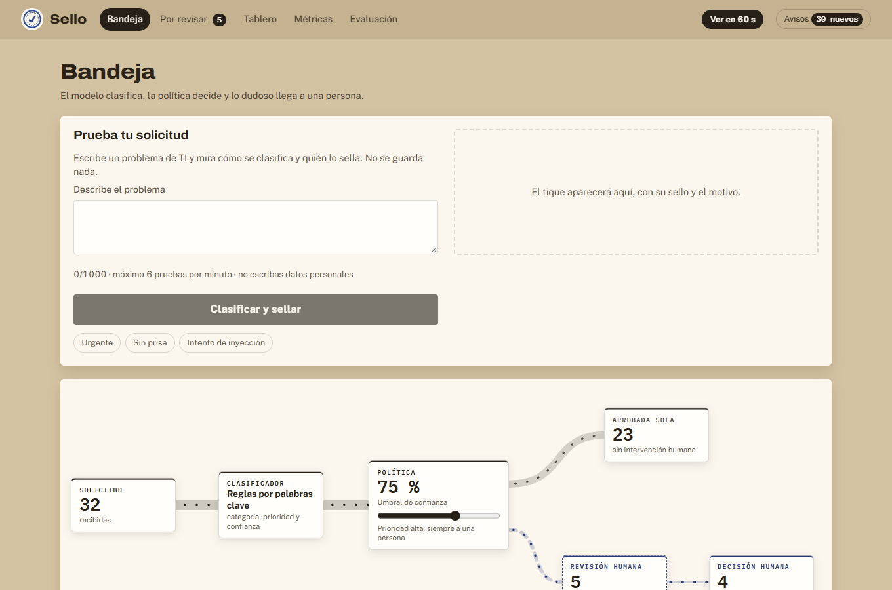 | 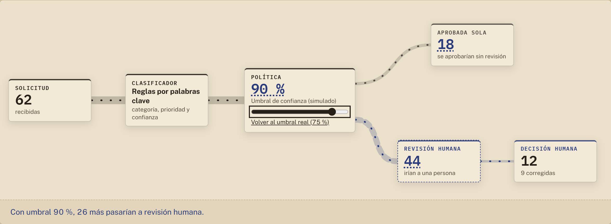 |

## Identidad: «Ventanilla»

Cada solicitud es un **tique de papel** que va recibiendo **sellos**: clasificada, revisión humana, corregida, resuelta. La paleta «kraft y tampón» vive en un solo archivo ([`tokens.css`](backend/app/landing/tokens.css)) que comparten el panel y la presentación:

- Escritorio de cartón kraft y tiques de papel claro de la misma familia; se separan por borde y sombra, no por brillo.
- Prioridad en tintas de tampón desaturadas: oxblood (alta), mostaza (media) y pizarra (baja), en franja, borde, texto y sello. El color nunca va solo: el texto lo nombra.
- El índigo es solo de la persona: discontinuo = espera a alguien; lleno = una persona lo selló. Grafito = lo aprobó la política sola.
- Archivo, IBM Plex Mono y Public Sans, servidas desde la propia app (sin CDN). Contraste AA en todos los pares de texto.

La presentación [`/como-funciona`](https://triaje-solicitudes-demo.onrender.com/como-funciona) cuenta tres casos reales de punta a punta: el tique queda fijo y recibe los sellos al bajar.

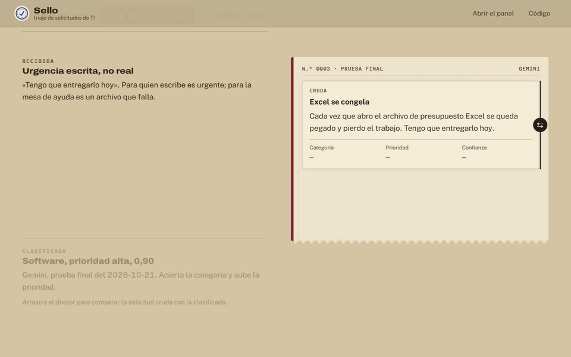

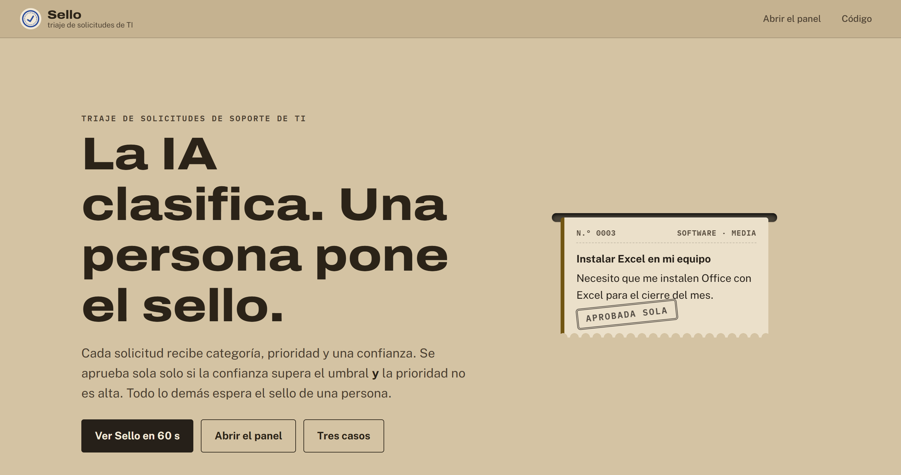

Sin librerías de UI ni de gráficos: SVG y CSS a mano. Foco visible, `prefers-reduced-motion` respetado y la presentación legible sin JavaScript. Capturas y demos se regeneran con [`scripts/capturas.py`](scripts/capturas.py) (Playwright y Edge, 1440×900 a 2x).

## Arquitectura

```
React + Vite  ──►  FastAPI  ──►  Clasificador (mock | gemini | anthropic)
 (Bandeja,          │
  Por revisar,      ├─ policy.py: decide y guarda el motivo (auto | revisión humana)
  Tablero,          ├─ SQLite + Alembic: solicitudes, historial, trabajo, avisos
  Métricas,         ├─ notify.py: webhook firmado (o simulado en la demo)
  Evaluación)       └─ eval/report_*.json (reportes guardados, GET /api/eval)
/como-funciona  ◄──  HTML estático servido por la API (landing/, tokens.css compartido)
```

- **Proveedores:** `mock` (reglas simples, sin costo), `gemini` (Google AI Studio, vía REST con `httpx`) y `anthropic`. Se elige con `LLM_PROVIDER`.
- **Robustez:** reintentos con espera ante 429/500/503, parada limpia si se agota la cuota, validación estricta de la salida del modelo y degradación segura a revisión humana. Lo que cae a respaldo queda marcado (`classifier_failed`), `/api/config` informa el estado del clasificador, `GET /api/requests?failed=true` lo filtra y `POST /api/requests/{id}/reclassify` lo vuelve a clasificar.
- **Por qué y cuándo:** cada solicitud guarda el motivo de la política (`model_failed`, `sensitive_priority`, `low_confidence` o `auto`) y el umbral vigente, y un historial que solo crece (`GET /api/requests/{id}/events`).
- **Trabajo y plazos:** después del triaje, cada solicitud va al equipo de su categoría (`TEAM_ROUTES`) y pasa por abierta → en curso → resuelta (`POST /api/requests/{id}/work`). El plazo depende de la prioridad vigente (`SLA_HOURS`, por defecto alta 4 h, media 24 h, baja 72 h) y corre hasta resolver.
- **Avisos:** cada cambio de estado genera un webhook con el payload JSON y `X-Sello-Signature: sha256=…` (HMAC del cuerpo exacto). Con `NOTIFY_URL` y `NOTIFY_SECRET` se envía fuera de la demo; si no, queda como «simulado» (`GET /api/notifications`). Un intento, sin reintentos.
- **Prueba sin guardar:** `POST /api/classify/preview` clasifica texto libre y aplica la política sin persistir nada; si el LLM no está configurado o falla, responde el clasificador de reglas y lo avisa.
- **Migraciones:** Alembic (`backend/migrations`). La API las aplica al arrancar; una base creada antes con `create_all` se marca como `0001` y sigue sin perder datos. Nueva migración: `cd backend; alembic revision --autogenerate -m "..."`.
- **Entrada idempotente:** `POST /api/requests` acepta la cabecera `Idempotency-Key`. Si quien envía reintenta con la misma clave (por ejemplo el [integrador de webhooks](https://github.com/JuanSGarciaC/integrador-webhooks), que entrega *al menos una vez*), recibe la solicitud original con `200` y no se clasifica de nuevo.
- **Seguridad:** el texto del usuario se trata como dato (instrucción anti-inyección en el prompt) y las claves viven en `.env`, que no se versiona.

## Resultados

Modelo `gemini-3.5-flash-lite`, umbral 0.75, corrida del 2026-10-21. Sin fallas de API ni salidas inválidas en ambas corridas.

| | Desarrollo (32 casos) | Prueba final (10 casos) |
|---|---|---|
| Exactitud de categoría | 94% (30/32) | 90% (9/10) |
| Exactitud de prioridad | 72% (23/32) | 60% (6/10) |
| Aprobadas automáticamente | 22/32 | 5/10 |
| Categoría correcta entre aprobadas | 22/22 | 4/5 |

La pantalla de Evaluación compara, sobre los mismos 10 casos de la prueba final, el LLM con el clasificador de reglas que se usa sin clave (medido el 2026-11-11):

| Prueba final (10 casos) | Gemini | Reglas por palabras clave |
|---|---|---|
| Exactitud de categoría | 90% (9/10) | 60% (6/10) |
| Exactitud de prioridad | 60% (6/10) | 50% (5/10) |
| Aprobadas automáticamente | 5/10 | 8/10 |
| Categoría correcta entre aprobadas | 4/5 | 6/8 |

Las reglas aprueban más solicitudes solas y se equivocan más en ellas: aprobar más no es mejor.

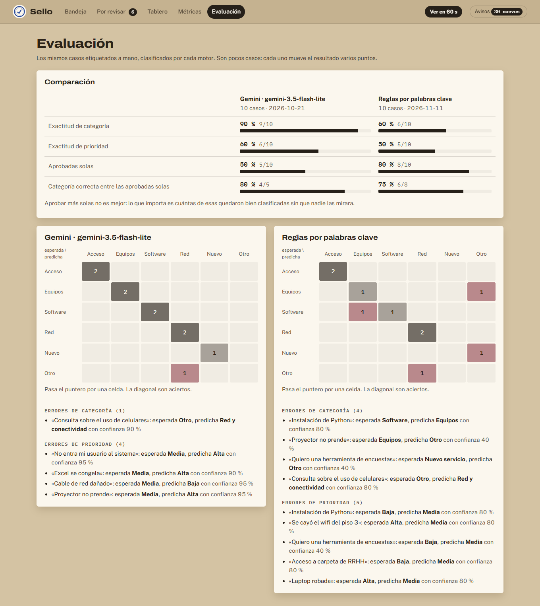

**Limitaciones**
- Todavía no hay inicio de sesión: el nombre de quien revisa o resuelve es texto libre.
- Los avisos se envían una sola vez, sin reintentos ni cola.
- Las muestras son pequeñas: un caso equivale a 3 puntos (desarrollo) o 10 (final).
- El prompt se ajustó con el set de desarrollo, por eso su cifra es optimista. La prueba final se ejecutó una sola vez, sin ajustes posteriores.
- Los errores de prioridad son sobre todo por exceso (el modelo sube la prioridad), lo que deriva el caso a revisión humana.
- La confianza que reporta el modelo está poco calibrada: responde 0.90 a 0.95 también cuando se equivoca. Un caso ambiguo de la prueba final se aprobó automáticamente por error; por eso se mantiene una persona en el circuito.
- Las etiquetas esperadas son criterio del autor y algunas son discutibles.

## Ejecutar

Con Docker (un contenedor: la API sirve el panel compilado):

```powershell
docker compose up -d --build
```

Abre http://localhost:8080. Usa el clasificador de reglas, sin costo. Para cargar datos de ejemplo: `$env:BASE_URL="http://localhost:8080"; python backend/scripts/seed_demo.py`.

### En desarrollo (Windows, PowerShell)

Backend:

```powershell
cd backend
python -m venv .venv
.\.venv\Scripts\Activate.ps1
pip install -r requirements.txt
copy ..\.env.example .env
pytest
uvicorn app.main:app --reload --port 8000
```

Frontend (otra terminal, requiere Node.js):

```powershell
cd frontend
npm install
npm run dev
```

Abre http://localhost:5173. La documentación interactiva de la API está en http://localhost:8000/docs. Para cargar datos de ejemplo, con el backend activo: `python scripts/seed_demo.py`.

### Usar Gemini (Google AI Studio)

Crea una clave en https://aistudio.google.com/apikey y edita `backend/.env`:

```
LLM_PROVIDER=gemini
GOOGLE_API_KEY=tu_clave
GEMINI_MODEL=gemini-3.5-flash-lite
```

Los nombres de modelo y las cuotas del plan gratuito cambian con frecuencia; verifica los vigentes en la documentación de Google. `.env` está en `.gitignore`: nunca subas la clave. Sin clave, `LLM_PROVIDER=mock` funciona sin costo.

## Evaluación

`backend/eval/` contiene 32 casos de desarrollo (`eval_set.csv`) y 10 de prueba final (`eval_final.csv`, que se corre una sola vez):

```powershell
python eval/run_eval.py --pausa 4
python eval/run_eval.py --csv eval/eval_final.csv --out eval/report_final_nuevo.md --pausa 4
```

El reporte incluye exactitud de categoría y prioridad, matriz de confusión y lista de errores, y cuenta aparte las fallas de API y las salidas inválidas del modelo. Se escribe en Markdown y en JSON; los `report_*.json` guardados son los que muestra la pantalla de Evaluación. `report_final.json` es la transcripción de `report_final.md` (corrida de Gemini del 2026-10-21), sin volver a llamar a la API.

## Pruebas y CI

| Qué | Cómo | Resultado (2026-11-21, local) |
|---|---|---|
| Unitarias e integración de la API (modo demo, migraciones 0001-0005, avisos firmados, plazos, tablero) | `pytest` en `backend/` | 39 pasan |
| E2E en navegador | `uv run --with pytest --with playwright pytest e2e` | 5 pasan |
| Linter | `ruff check` | sin hallazgos |
| Compilación del panel | `npm run build` (incluye `tsc`) | sin errores |

Las E2E envían solicitudes reales, comprueban la rama que toman, corrigen una desde la cola de revisión, verifican que la corrección aparece en el detalle y que «Prueba tu solicitud» sella sin guardar. En local corren con Edge contra `uvicorn` (`BASE_URL`, `BROWSER_CHANNEL=msedge`); en CI, contra el contenedor. La interfaz se revisa además con Playwright en escritorio, 390 px, sin JS y con `prefers-reduced-motion`. GitHub Actions ejecuta todo en cada push.

## Estructura

```
backend/   app/ (main, classifier, policy, models, notify, landing/)  migrations/  eval/  scripts/  tests/
frontend/  src/ (Flow: lienzo; TryIt; Tour; Notices; Reply; pages: Inbox, Review, Board, Metrics, Evaluation)
e2e/       pruebas en navegador
scripts/   capturas.py (capturas y demos animadas del README)
docs/      img/ (capturas y GIF)  superpowers/specs/ (diseño del rediseño)
```

## Cómo se construyó

Con asistentes de IA (Claude); el autor revisó el código, lo ejecutó, definió los casos de evaluación y midió los resultados.

## Licencia

Todos los derechos reservados. El código se publica para consulta como parte de mi portafolio: puedes leerlo, pero no usarlo, copiarlo, modificarlo ni distribuirlo sin mi autorización por escrito. Ver [LICENSE](LICENSE).
